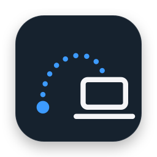
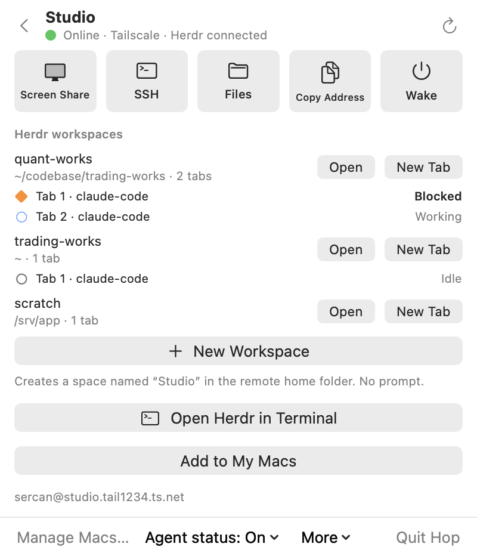

<p align="center">
  
</p>

<h1 align="center">Hop</h1>

<p align="center">A tiny macOS menu-bar launcher for your remote Macs.<br>
One click to Screen Share, SSH or open files, with Macs on your Tailscale network found automatically,<br>
plus your Herdr workspaces and agents on those Macs.</p>

<p align="center">
  <a href="https://sercanatalik.github.io/hop-remote-launcher/"><b>Website</b></a> ·
  <a href="#install"><b>Install</b></a> ·
  <a href="#set-up-your-remote-macs"><b>Set up your remote Macs</b></a>
</p>

<p align="center">
  <picture>
    <source media="(prefers-color-scheme: dark)" srcset="docs/screenshots/popover-dark.png">
    
  </picture>
  &nbsp;&nbsp;
  <picture>
    <source media="(prefers-color-scheme: dark)" srcset="docs/screenshots/mac-detail-dark.png">
    
  </picture>
</p>

---

## What it does

Click the Hop icon in the menu bar. A panel lists every Mac you use, each with a status mark: a green dot for online, a hollow ring for offline, a dashed ring while Hop is still checking.

Each Mac has one-click buttons for the things you do most:

- **Screen Share**: opens macOS's built-in Screen Sharing (`vnc://`)
- **SSH**: opens a terminal session (`ssh://`)
- **Files**: connects in Finder (`smb://`). The button is dimmed when the Mac is online but File Sharing appears to be off there.

The three buttons appear when you point at a Mac's row. Click a Mac's name for everything else: **Copy Address**, and **Wake**, which sends a Wake-on-LAN packet when you've set a MAC address.

Macs live in two groups:

- **My Macs** are the ones you add yourself, by Bonjour name, IP address or Tailscale name.
- **Tailscale** lists every Mac on your tailnet automatically, with live online status. Hop reads it from the Tailscale app already on your Mac, so no API key is needed. Click one and choose **Add to My Macs** from its **…** menu to save it, where you can rename it or set a user name. My Macs is shown once you have saved one.

The **More** menu at the top of the panel has **Manage Macs…**, Open Screen Sharing, GitHub, Report an Issue, About and **Quit Hop**. ⌘R refreshes, ⌘, opens Manage Macs and ⌘Q quits while the panel is open.

Hop is a single Swift file with no dependencies, no account and no telemetry. Your list stays in `~/Library/Application Support/Hop/hosts.json`.

## Herdr workspaces

If you use [Herdr](https://herdr.dev) to run coding agents on your Macs, Hop shows the workspaces on each one and gets you into them. Nothing here appears unless Herdr is installed.

A Mac shows its Herdr workspaces when the Herdr desktop app has it as a machine (**Settings → Machines** in Herdr) under the same host name Hop uses. Each workspace has:

- **Open**: shows that workspace in the Herdr desktop app. In the panel, click the workspace's name.
- **New Tab**: adds a tab with a new terminal to it, in the workspace's own folder. In the panel, click its **+**.

**New Workspace** creates a workspace on that Mac in one click. It is named after the Mac, starts in the home folder there, and asks nothing first. Rename or close workspaces in Herdr.

**Open Herdr in Terminal** attaches the Herdr terminal app (`herdr --remote`) to the Mac in a terminal window. It is offered for every Mac when the `herdr` command is installed.

Workspaces are listed while the Herdr desktop app is open. With Herdr closed, New Workspace still works and starts Herdr first.

### Agent status

Hop also shows what the agents in those workspaces are doing:

- the menu-bar icon shows how many agents are **blocked**, waiting for you
- a banner at the top of the panel names each workspace with a blocked agent, with an **Open** button
- each workspace shows counts, such as "1 working, 1 done"; a Mac's detail view lists every agent with its tab and state

The states are working, blocked, done and idle. Status updates every 30 seconds and when you refresh.

Agent status is on by default. Use **Agent status** in the panel's **More** menu, or in the Manage Macs toolbar, to **mute it for 8 hours or 1 week**, or turn it **off**. A mute ends by itself; off stays off until you turn it back on. While muted or off, Hop shows no agent status anywhere, and workspaces and their buttons stay.

<p align="center">
  <picture>
    <source media="(prefers-color-scheme: dark)" srcset="docs/screenshots/muted-dark.png">
    
  </picture>
</p>

## Install

Hop needs macOS 13 or later. It runs on Apple silicon and Intel Macs.

### Build from source

1. Install the Xcode Command Line Tools, if you haven't:

   ```bash
   xcode-select --install
   ```

2. Get the code, build Hop and copy it to Applications:

   ```bash
   git clone https://github.com/sercanatalik/hop-remote-launcher.git
   cd hop-remote-launcher
   ./build.sh --install
   ```

Hop is copied to Applications and starts by itself. Its icon appears in the menu bar.

`./build.sh` alone builds `build/Hop.app` without installing it. `UNIVERSAL=1 ./build.sh` builds one app for both Apple silicon and Intel.

### Download the app

1. Get `Hop.zip` from the [releases page](https://github.com/sercanatalik/hop-remote-launcher/releases) and unzip it.
2. Move **Hop.app** to Applications.
3. Hop isn't notarised by Apple yet, so macOS blocks it the first time. Try to open it once, then go to **System Settings → Privacy & Security** and click **Open Anyway**. Or run this:

   ```bash
   xattr -dr com.apple.quarantine /Applications/Hop.app
   ```

### Update or remove

To update, pull the latest code and run `./build.sh --install` again, or download the newer `Hop.zip` and replace the app. To remove Hop, quit it, delete **Hop.app** from Applications, and delete `~/Library/Application Support/Hop` if you also want your Mac list gone.

## Set up your remote Macs

On each remote Mac, open **System Settings → General → Sharing** and turn on:

| Feature in Hop | Turn on |
| --- | --- |
| Screen Share | **Screen Sharing** |
| SSH, Open Herdr in Terminal | **Remote Login** |
| Files | **File Sharing** |

**Away from home:** install [Tailscale](https://tailscale.com) on every Mac, and they show up in Hop wherever you are, with no port forwarding.

**Wake-on-LAN** only works on the same local network. It also needs "Wake for network access" turned on in the remote Mac's Battery or Energy settings, and MacBooks usually only wake this way when plugged in.

The first time Hop starts, macOS may ask for **Local Network** access. Allow it, or every Mac stays marked offline.

## Contributing

Issues and pull requests are welcome. Use **Report an Issue…** in Hop's **More** menu, or [open one here](https://github.com/sercanatalik/hop-remote-launcher/issues/new).

Hop is deliberately small: one Swift file (`Hop.swift`) and a build script, with no Xcode project. Every push is built on a real Mac by GitHub Actions. To publish a release, push a tag like `v1.0.0`, and the workflow attaches a universal `Hop.zip`.

## License

[MIT](LICENSE) © 2026 Sercan Atalik
