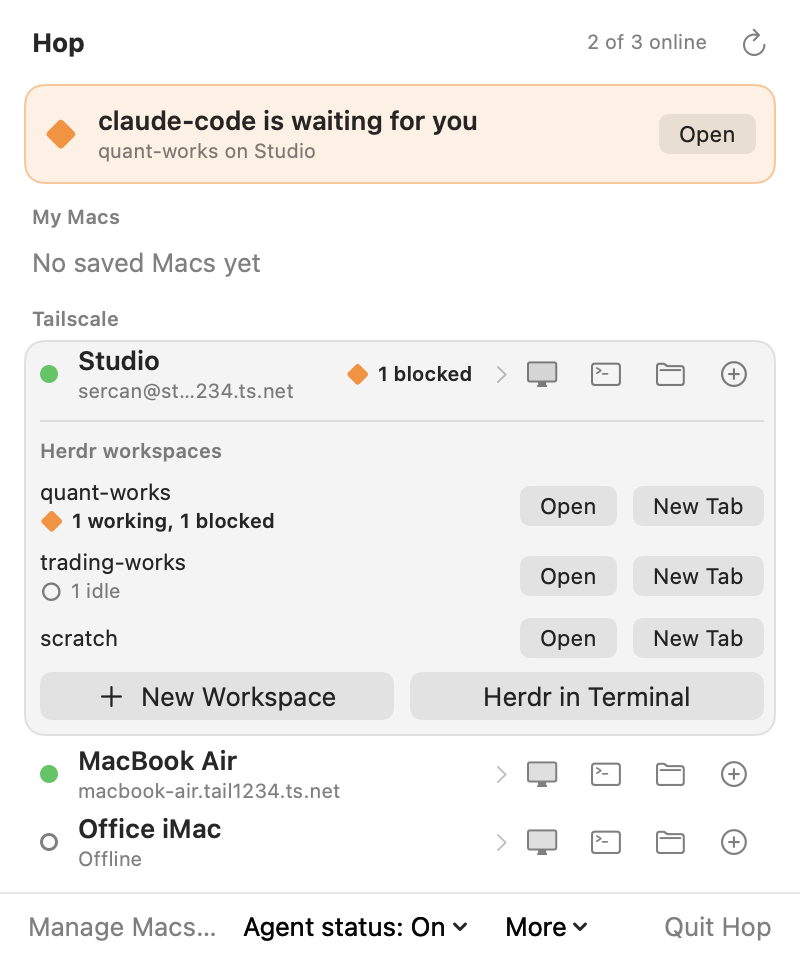
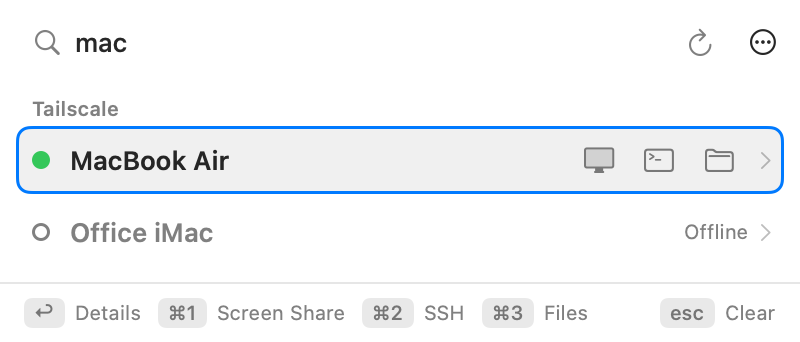
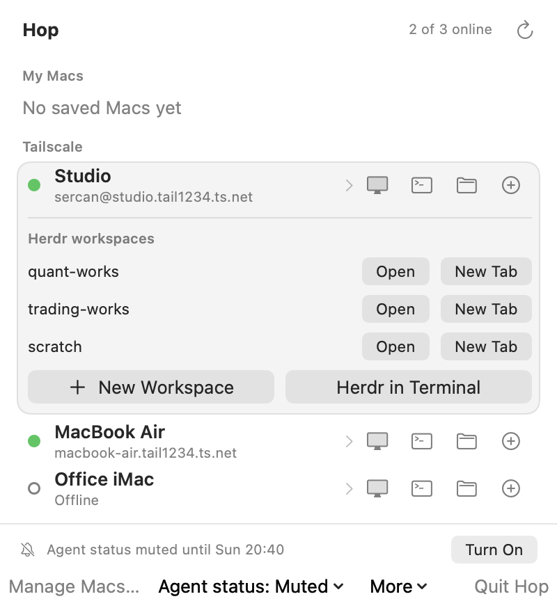

<p align="center">
  
</p>

<h1 align="center">Hop</h1>

<p align="center">A tiny macOS menu-bar launcher for your remote computers.<br>
One click, or a few keys, to Screen Share, SSH or open files on any of your Macs,<br>
with the ones on your Tailscale network found automatically, Windows PCs and Linux machines too,<br>
plus your Herdr workspaces and agents.</p>

<p align="center">
  <a href="https://github.com/sercanatalik/hop-remote-launcher/releases/latest/download/Hop.zip"><b>Download</b></a> ·
  <a href="https://sercanatalik.github.io/hop-remote-launcher/"><b>Website</b></a> ·
  <a href="#install"><b>Install</b></a> ·
  <a href="#set-up-your-remote-computers"><b>Set up your remote computers</b></a> ·
  <a href="https://github.com/sercanatalik/hop-remote-launcher/releases/latest"><b>Release notes</b></a>
</p>

<p align="center">
  <picture>
    <source media="(prefers-color-scheme: dark)" srcset="docs/screenshots/popover-dark.png">
    
  </picture>
  &nbsp;&nbsp;
  <picture>
    <source media="(prefers-color-scheme: dark)" srcset="docs/screenshots/mac-detail-dark.png">
    
  </picture>
</p>

---

## What it does

Click the Hop icon in the menu bar. A panel lists every Mac you use, each with a status mark: a green dot for online, a hollow ring for offline, a dashed ring while Hop is still checking.

Point at a Mac and three buttons appear for the things you do most:

- **Screen Share**: opens macOS's built-in Screen Sharing (`vnc://`)
- **SSH**: opens a terminal session (`ssh://`)
- **Files**: connects in Finder (`smb://`)

A button is dimmed when the Mac is online but that service appears to be off there. It still works if you click it, since the check can be a few seconds old.

Click a Mac's name for everything else: its response time, **Copy Address**, and **Wake**, which sends a Wake-on-LAN packet when you've set a MAC address.

Macs live in two groups:

- **My Macs** are the ones you add yourself, by Bonjour name, IP address or Tailscale name. The group is shown once you have saved one.
- **Tailscale** lists every Mac on your tailnet automatically, with live online status. Hop reads it from the Tailscale app already on your Mac, so no API key is needed. Click one and choose **Add to My Macs** from its **…** menu to save it, where you can rename it or set a user name.

**Manage Macs…** and **Quit Hop** are at the bottom of the panel. The **More** menu at the top has agent status, Open Screen Sharing, GitHub, Report an Issue and About. ⌘R refreshes, ⌘, opens Manage Macs and ⌘Q quits while the panel is open.

Hop is a single Swift file with no dependencies, no account and no telemetry. Your list stays in `~/Library/Application Support/Hop/hosts.json`.

### Keyboard

Set a global shortcut under **Shortcut** in the Manage Macs toolbar (⌃⌥Space, ⌃⌥H or ⌥⌘H; off by default) to open the panel from any app. Press it again to close.

With the panel open, just type to filter the list by name or address. While you type:

<p align="center">
  <picture>
    <source media="(prefers-color-scheme: dark)" srcset="docs/screenshots/keyboard-dark.png">
    
  </picture>
</p>

| Key | Does |
|---|---|
| ↑ ↓ | Move the highlight |
| ↩ | Open the highlighted Mac's details |
| ⌘1, ⌘2, ⌘3 | Screen Share, SSH, Files on the highlighted Mac |
| esc | Clear what you typed; press again to close the panel |

### Alerts

Hop can tell you when a saved Mac goes offline or comes back, without the panel being open. Turn on **Alerts** in the Manage Macs toolbar; macOS asks once for permission to show notifications. A Mac is reported after it misses two checks, about a minute, and nothing is reported when your own Mac loses its network or has just woken. Macs listed only from Tailscale are not reported until you add them to My Macs.

### Windows and Linux computers

Hop also reaches computers that are not Macs. Turn off **Only Macs** in the Manage Macs toolbar's Tailscale menu to list the Windows and Linux computers on your tailnet, or add one yourself and set its **Platform** in Manage Macs.

- A **Windows** PC gets **Remote Desktop** in place of Screen Share. Hop hands the connection to a remote desktop app on your Mac, such as Microsoft's free [Windows App](https://apps.apple.com/app/id1295203466); if none is installed, the button is dimmed and takes you to it.
- A **Linux** machine keeps Screen Share, for a VNC server.

Phones, tablets and TVs on your tailnet are never listed.

### Hosts from your SSH config

If you keep machines in `~/.ssh/config`, Manage Macs lists them under **From SSH config**; click the **+** beside one to add it to My Macs with its name, address and user filled in. SSH to a Mac added this way goes through its entry in the file, so its port, key and jump host apply. Hop only reads the file.

## Herdr workspaces

If you use [Herdr](https://herdr.dev) to run coding agents on your Macs, Hop shows the workspaces on each one and gets you into them. Nothing here appears unless Herdr is installed.

A Mac shows its Herdr workspaces when the Herdr desktop app has it as a machine (**Settings → Machines** in Herdr) under the same host name Hop uses. Each workspace has:

- **Open**: shows that workspace in the Herdr desktop app. In the panel, click the workspace's name.
- **New Tab**: adds a tab with a new terminal to it, in the workspace's own folder. In the panel, click its **+**.
- **Rename**: in a Mac's detail view, point at a workspace and click the pencil beside its name. Return saves, Esc cancels, and an empty name puts back the one Herdr takes from the folder. Hop stays in front.

**New Workspace** creates a workspace on that Mac in one click. It is named after the Mac, starts in the home folder there, and asks nothing first. Close workspaces in Herdr.

**Open Herdr in Terminal** attaches the Herdr terminal app (`herdr --remote`) to the Mac in a terminal window. It is in the **…** menu of a Mac's detail view, for every Mac, when the `herdr` command is installed.

Workspaces are listed while the Herdr desktop app is open. With Herdr closed, New Workspace still works and starts Herdr first.

### Agent status

Hop also shows what the agents in those workspaces are doing:

- the menu-bar icon shows how many agents are **blocked**, waiting for you
- a banner at the top of the panel names each workspace with a blocked agent, with an **Open** button
- each workspace shows counts, such as "1 working, 1 done"; a Mac's detail view lists every agent with its tab and state

The states are working, blocked, done and idle. Status updates every 30 seconds and when you refresh.

### Agent notifications

Hop posts a macOS notification when an agent starts waiting for you. Click it, or its **Open Workspace** button, to show that workspace in Herdr; **Mute for 8 Hours** mutes agent status. When several agents start waiting at once you get one notification that counts them, and clicking it opens the Hop panel. A waiting notification leaves Notification Center once the agent is no longer waiting.

The choices are in **Alerts** in the Manage Macs toolbar:

- **Notify when an agent is waiting for you**: on by default
- **Notify when an agent finishes**: off by default
- **Stay quiet for the workspace open in Herdr**: off by default. When on, the workspace Herdr is showing does not notify while Herdr is in front, since you can already see that agent; every other workspace still does

Agent notifications follow agent status: while it is muted or off there are none, and nothing is reported afterwards for what happened in the meantime. An agent that is already waiting when Hop or Herdr starts is not reported either. Hop learns about agents from the Herdr desktop app, so Herdr must be open, and a notification can arrive up to 30 seconds after the agent stopped. macOS asks whether Hop may send notifications the first time there is one to show.

Agent status is on by default. Use **Agent status** in the panel's **More** menu, or in the Manage Macs toolbar, to **mute it for 8 hours or 1 week**, or turn it **off**. A mute ends by itself; off stays off until you turn it back on. While muted or off, Hop shows no agent status anywhere, a crossed-out bell at the top of the panel turns it back on, and workspaces and their buttons stay.

<p align="center">
  <picture>
    <source media="(prefers-color-scheme: dark)" srcset="docs/screenshots/muted-dark.png">
    
  </picture>
</p>

## Install

Hop needs macOS 13 or later. It runs on Apple silicon and Intel Macs.

### Homebrew

Install via Homebrew:

```bash
brew install --cask sercanatalik/hop-remote-launcher/hop
```

### Download the app

1. Download [`Hop.zip`](https://github.com/sercanatalik/hop-remote-launcher/releases/latest/download/Hop.zip), the latest release, and unzip it. Older versions are on the [releases page](https://github.com/sercanatalik/hop-remote-launcher/releases).
2. Move **Hop.app** to Applications.
3. Hop isn't notarised by Apple yet, so macOS blocks it the first time. Try to open it once, then go to **System Settings → Privacy & Security** and click **Open Anyway**. Or run this:

   ```bash
   xattr -dr com.apple.quarantine /Applications/Hop.app
   ```

### Build from source

1. Install the Xcode Command Line Tools, if you haven't:

   ```bash
   xcode-select --install
   ```

2. Get the code, build Hop and copy it to Applications:

   ```bash
   git clone https://github.com/sercanatalik/hop-remote-launcher.git
   cd hop-remote-launcher
   ./build.sh --install
   ```

Hop is copied to Applications and starts by itself. Its icon appears in the menu bar.

`./build.sh` alone builds `build/Hop.app` without installing it. `UNIVERSAL=1 ./build.sh` builds one app for both Apple silicon and Intel.

### Update or remove

To update, download the newer `Hop.zip` and replace the app, or pull the latest code and run `./build.sh --install` again. To remove Hop, quit it, delete **Hop.app** from Applications, and delete `~/Library/Application Support/Hop` if you also want your Mac list gone.

## Set up your remote computers

On each remote Mac, open **System Settings → General → Sharing** and turn on:

| Feature in Hop | Turn on |
| --- | --- |
| Screen Share | **Screen Sharing** |
| SSH, Open Herdr in Terminal | **Remote Login** |
| Files | **File Sharing** |

On a Windows PC, turn on **Remote Desktop** (Settings → System → Remote Desktop; Windows Home does not offer it) for Remote Desktop, the **OpenSSH Server** optional feature for SSH, and share a folder for Files. On Linux, run an SSH server, and a VNC or Samba server if you want Screen Share or Files.

**Away from home:** install [Tailscale](https://tailscale.com) on every computer, and they show up in Hop wherever you are, with no port forwarding.

**Wake-on-LAN** only works on the same local network. It also needs "Wake for network access" turned on in the remote Mac's Battery or Energy settings, and MacBooks usually only wake this way when plugged in.

The first time Hop starts, macOS may ask for **Local Network** access. Allow it, or every Mac stays marked offline.

## Troubleshooting

| You see | What to do |
| --- | --- |
| "Tailscale isn't running" while Tailscale is running | Update Hop. Versions before 1.1.1 showed this whenever Hop was opened from Finder or at login. |
| Every Mac is marked offline | Allow Hop under **System Settings → Privacy & Security → Local Network**. |
| A button is dimmed | That service appears to be off on that computer. Turn it on there (see the table above); the button still tries if you click it. |
| Remote Desktop is dimmed on every Windows PC | No remote desktop app is installed on your Mac. Click the button to get Windows App. |
| A host from your SSH config shows as offline | It is probably only reachable through a jump host. SSH still works; Screen Share and Files won't. |
| The global shortcut does nothing, or Manage Macs says it is unavailable | Another app holds that shortcut. Choose a different one. |

Remote Desktop to a Windows PC has not been tested against a real PC yet. If it doesn't connect for you, please [report it](https://github.com/sercanatalik/hop-remote-launcher/issues/new).

## Contributing

Issues and pull requests are welcome. Use **Report an Issue…** in Hop's **More** menu, or [open one here](https://github.com/sercanatalik/hop-remote-launcher/issues/new).

Hop is deliberately small: one Swift file (`Hop.swift`) and a build script, with no Xcode project. Every push is built on a real Mac by GitHub Actions. To publish a release, push a tag like `v1.1.1`, and the workflow attaches a universal `Hop.zip`.

## License

[MIT](LICENSE) © 2026 Sercan Atalik
